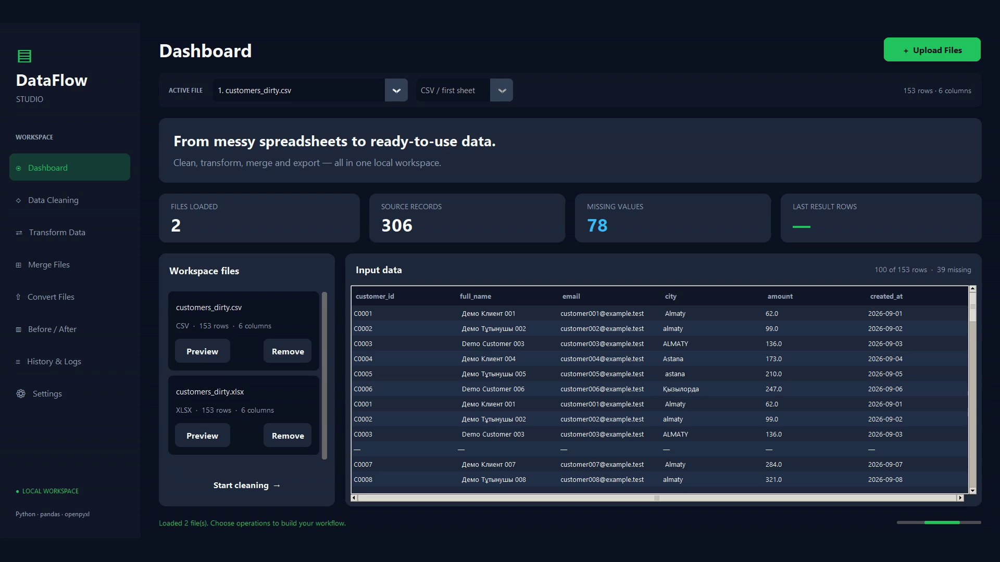
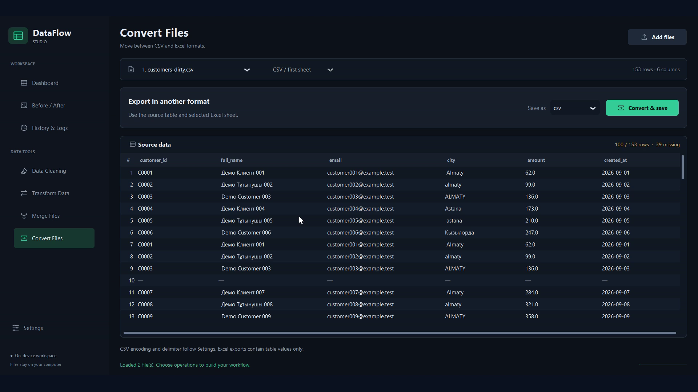
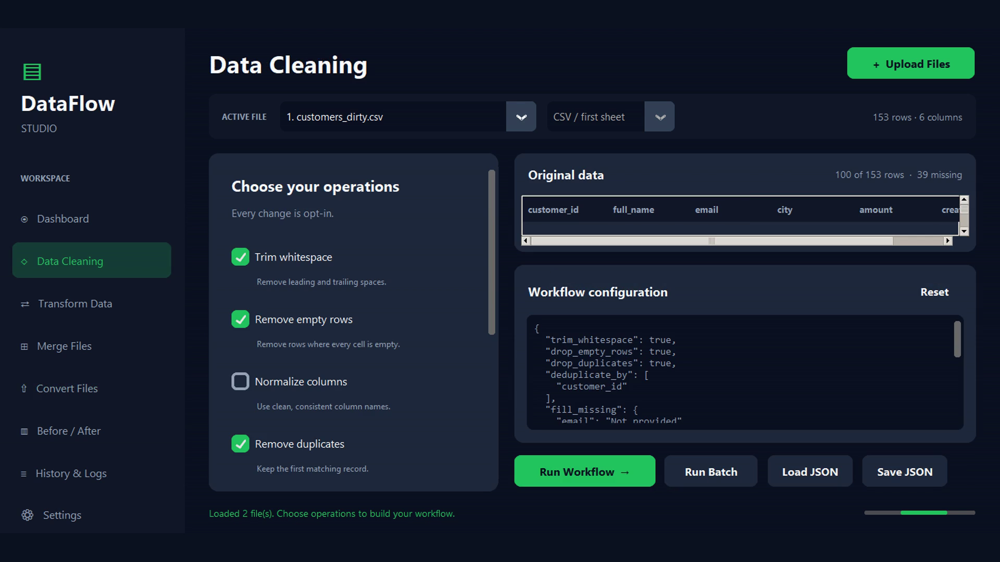
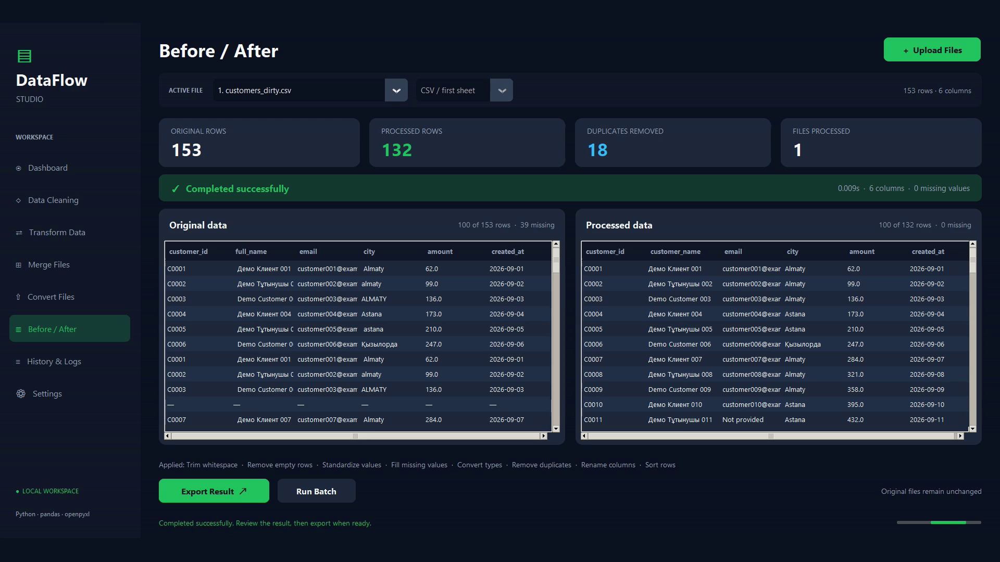
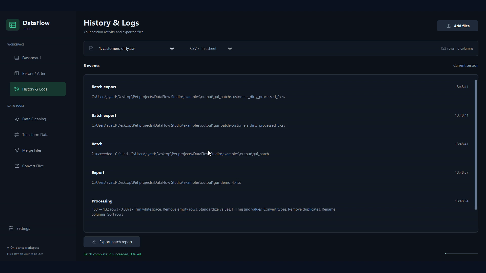

# DataFlow Studio

**Professional Excel & CSV Automation with Python**

[](https://www.python.org/)
[](https://github.com/Dxniar/dataflow-studio/actions/workflows/ci.yml)
[](LICENSE)

Clean messy customer tables, compare the changes, and export a result you can inspect. DataFlow Studio combines a local desktop application with a CLI for repeatable CSV and Excel workflows. Both interfaces use the same Python processing engine.

This is an **AI-assisted personal portfolio project**. Every included customer record is synthetic. It is not a paid client case study, and it makes no claims about commercial results.

Version **1.2** adds typed import schemas, read-only data checks with rejected-record exports, persistent local workspaces, and cancellable jobs with batch recovery. It retains the refined desktop workspace introduced in 1.1.



## The problem it solves

Small-business spreadsheets often arrive with repeated records, missing values, extra whitespace and inconsistent city names. Repeating the same cleanup manually makes it difficult to explain what changed or apply the same rules to the next file. DataFlow Studio turns those choices into an explicit workflow, with before/after counts and reusable JSON configuration.

## Features

- **Read CSV and XLSX:** choose worksheet, encoding, delimiter, column types, explicit date formats and numeric separators before importing. Text IDs keep stored leading zeroes.
- **Check data:** required columns/values, unique IDs, allowed values and numeric/date bounds; export rejected source records with readable reasons.
- **Keep a workspace:** preferences, workflow, import schema, validation rules, recent paths, history and job checkpoints persist locally without table snapshots.
- **Clean deliberately:** remove duplicates using all columns or selected keys, remove empty rows, trim text, fill missing values, normalize headers and map inconsistent values.
- **Transform:** rename, drop, select and reorder columns; convert types; filter and sort rows.
- **Merge:** append rows with union, strict or intersection column alignment.
- **Convert:** CSV to XLSX and XLSX to CSV, including English, Russian and Kazakh text.
- **Batch:** apply one workflow to multiple files, request cancellation, retain completed exports and retry only failed/pending files using saved options.
- **Compare:** retain original and processed data, display calculated metrics, and preview up to 100 rows per table.
- **Export safely:** protect input paths, reject existing filenames or create unique names, and publish complete temporary output files without overwriting existing data.
- **Automate:** use the Typer CLI and validated JSON configuration. No Python expression evaluation is accepted in configuration.
- **Stay responsive:** desktop file and processing jobs run in background threads; widget updates stay on the Tk main thread.

## Installation

For Windows, download and extract the [portable app](https://github.com/Dxniar/dataflow-studio/releases/download/v1.2.0/DataFlowStudio-Windows.zip), then open `DataFlowStudio.exe`. Keep the full extracted folder together. The [release](https://github.com/Dxniar/dataflow-studio/releases/tag/v1.2.0) also includes the source ZIP and SHA-256 checksums. The [1.1 demonstration video](https://github.com/Dxniar/dataflow-studio/releases/download/v1.1.0/dataflow-studio-demo.mp4) documents the earlier interface; see [1.2 workflow documentation](docs/PRODUCTION_WORKFLOWS.md) for the new features.

Python 3.11 or newer with Tk support is required. Python 3.12 is recommended for the Windows build. From the repository root:

```powershell
py -3.12 -m venv .venv
.\.venv\Scripts\python.exe -m pip install -e ".[dev]"
```

For Linux or macOS, create the environment with `python3 -m venv .venv`, then install with `.venv/bin/python -m pip install -e '.[dev]'`. Some Linux distributions package Tk separately as `python3-tk`.

The examples below use Windows executable paths so PowerShell environment activation is optional. On Linux/macOS, use `.venv/bin/python` and `.venv/bin/dataflow` instead.

## Quick start

```powershell
# Launch the desktop application
.\.venv\Scripts\python.exe -m dataflow

# Run the complete synthetic demo and verify its outputs
.\.venv\Scripts\python.exe scripts/run_demo.py

# Inspect CLI commands
.\.venv\Scripts\dataflow.exe --help
```

The demo creates cleaned CSV/XLSX files, a merged table, batch exports and a JSON report in `examples/output/`. Repeated runs use unique spreadsheet filenames. The source files are checked for changes with SHA-256 hashes.

## GUI usage

1. Click **Add files**, choose `.csv`/`.xlsx` files and review **Import settings** before loading. Choose **Text** for IDs, and set date/number formats when needed. The top-bar **Import settings** button reimports the active source safely.
2. In **Data Cleaning**, choose operations and optional duplicate key columns. Add a replacement rule to fill missing values.
3. In **Transform Data**, add rename, selection, ordering, conversion, mapping, filter or sorting rules. Review the workflow configuration.
4. Click **Run Workflow**, then inspect **Before / After**. Each run starts from the loaded original table.
5. Click **Export Result** to save a new CSV or XLSX file. Use **Run Batch** to apply the same workflow to all workspace files.
6. Use **Merge Files** to append tables or **Convert Files** for format conversion. Inspect outcomes in **History & Logs**.
7. In **Data Validation**, build checks, click **Check data**, then **Export rejected rows** to save the original problem records and reasons. Validation does not clean or change records.
8. **Cancel** stops at a safe boundary. **History & Logs** shows saved batch jobs and **Resume / retry**. After restarting, **Restore saved files** reloads recent sources explicitly.

**Load** and **Save** reuse JSON transformation workflows. The workflow panel lists selected operations; **View JSON** opens their configuration separately. **Settings** controls appearance, export folder, encoding, delimiter, collision policy, batch format and logging. Preferences and history survive restart; source table contents are not stored in the workspace database. See [reliable workflow details](docs/PRODUCTION_WORKFLOWS.md) for import/rule JSON, safety limits, cancellation and recovery semantics.

The desktop preview is limited to 100 rows; it always reports the full row count. Processing works on the complete in-memory table.

| Input data | Explicit processing |
| --- | --- |
|  |  |

## CLI usage

```powershell
# Inspect rows, columns, types and missing counts without printing cell contents
.\.venv\Scripts\dataflow.exe inspect examples/input/customers_dirty.csv

# Clean only the operations explicitly selected here
.\.venv\Scripts\dataflow.exe clean examples/input/customers_dirty.xlsx --sheet Customers --trim-whitespace --drop-empty-rows --drop-duplicates --deduplicate-by customer_id --output examples/output/cleaned.xlsx --collision unique

# Run the full demo workflow
.\.venv\Scripts\dataflow.exe process examples/input/customers_dirty.csv --config examples/demo_config.json --output examples/output/processed.xlsx --collision unique

# Filter amounts and sort descending using a configuration file
.\.venv\Scripts\dataflow.exe process examples/input/customers_dirty.csv --config examples/filter_config.json --output examples/output/high_value.csv --collision unique

# Convert in either direction
.\.venv\Scripts\dataflow.exe convert examples/input/customers_dirty.csv --output examples/output/converted.xlsx --collision unique
.\.venv\Scripts\dataflow.exe convert examples/input/customers_dirty.xlsx --sheet Customers --output examples/output/converted.csv --collision unique

# Append compatible tables
.\.venv\Scripts\dataflow.exe merge examples/input/customers_part_a.csv examples/input/customers_part_b.csv --mode strict --output examples/output/merged.csv --collision unique

# Apply the same workflow independently to CSV and Excel inputs
.\.venv\Scripts\dataflow.exe batch examples/input/customers_dirty.csv examples/input/customers_dirty.xlsx --config examples/demo_config.json --output-dir examples/output/batch --format xlsx
```

All file commands support `--sheet`, `--encoding` and `--delimiter`. A worksheet can be selected by name or zero-based index. Use `--sheet name:2025` for a worksheet whose name is numeric. Pass `--delimiter ';'` for semicolon CSV, or `--delimiter '\t'` for tabs. UTF-8 with BOM (`utf-8-sig`) is the default encoding.

`clean` also accepts repeated `--fill-missing COLUMN=VALUE` and `--drop-column COLUMN` options. `--fill-missing amount=0` uses a numeric replacement; `--fill-missing city=Unknown` uses text. Multiple duplicate keys use repeated `--deduplicate-by` options and require `--drop-duplicates`.

`clean` and `process` can omit `--output`; a unique `INPUT_processed` filename is then selected. Explicit output paths default to collision errors. `--collision unique` creates a numbered alternative. Source paths are always protected, and no force-overwrite option is provided. Use the output path in the JSON report when a unique name is selected.

Add global `--verbose` before the command to log metadata to stderr. Success reports are JSON on stdout. Exit codes: **0** success, **1** processing/configuration/file error, **2** invalid CLI usage, **3** a batch with both successful and failed files.

## Example configuration

All operations are disabled unless explicitly selected. For example:

```json
{
  "trim_whitespace": true,
  "drop_empty_rows": true,
  "drop_duplicates": true,
  "deduplicate_by": ["customer_id"],
  "fill_missing": {"amount": 0},
  "convert_types": {"amount": "float"},
  "rename_columns": {"full_name": "customer_name"},
  "filters": [{"column": "amount", "operator": "greater_than", "value": 100}],
  "sort_by": ["customer_id"]
}
```

The fixed operation order is: **trim → drop empty rows → normalize headers → standardize values → fill missing values → convert types → deduplicate → rename → drop columns → select → reorder → filter → sort**. Column references use the names present at that stage. JSON key order does not change execution order.

Filters support `equals`, `not_equals`, `contains`, `greater_than`, `less_than`, `is_empty` and `is_not_empty`. Multiple conditions are combined with AND. `contains` is literal and case-sensitive. Numeric comparisons require numeric columns; use `convert_types` where needed. Available target types are `string`, `integer`, `float`, `datetime` and `boolean`.

Unknown options, duplicate JSON keys, invalid values and unavailable columns produce readable errors. See the [configuration and API reference](docs/API_CONTRACT.md) and [complete demo configuration](examples/demo_config.json).

## Before / after

The generated customer fixture contains **153 rows**, including **18 duplicate records** and **3 fully empty rows**. Applying `examples/demo_config.json` produces **132 rows** and retains six columns. These are reproducible fixture results, not performance or business claims. The application calculates its own summary from each run.





See the [demo walkthrough](docs/DEMO.md), [60-second recording storyboard](docs/VIDEO_SCRIPT.md) and [honest portfolio description](docs/PORTFOLIO.md). Screenshots are intended to document the running application; the validation record identifies completed checks and artifacts.

## Testing and verification

```powershell
.\.venv\Scripts\python.exe -m pytest
.\.venv\Scripts\python.exe -m ruff check .
.\.venv\Scripts\python.exe -m ruff format --check .
.\.venv\Scripts\python.exe scripts/run_demo.py
```

Tests cover cleaning, transformations, strict configuration, Unicode, conversion, schema alignment, invalid files, output protection, partial batch failure and CLI/GUI-controller parity. GUI-controller tests run without a display. The GitHub workflow runs the suite on Windows and Linux with Python 3.11, 3.12 and 3.13, and builds a Windows distribution.

See [the validation record](docs/VALIDATION.md) for actual local checks, desktop verification, build results and remote CI status. The CI badge reports the remote workflow state; configuration alone is not evidence of a passing run.

## Windows distribution

Build on Windows after installing the development dependencies:

```powershell
.\.venv\Scripts\python.exe scripts/build_windows.py
```

PyInstaller creates `dist/DataFlowStudio/DataFlowStudio.exe` and its supporting files. Keep the entire folder together, including `_internal`. This is a portable, unsigned application, not an installer. Build and launch verification are documented in the validation record.

## Architecture and project structure

```text
src/dataflow/
  core/          Reading, validation, transformations, metrics and safe exports
  gui/           CustomTkinter shell, pages, table components and worker controller
  cli.py         Typer argument handling and JSON result reporting
  __main__.py    Desktop entry point
tests/           Core, CLI and headless controller acceptance tests
examples/        Synthetic CSV/XLSX inputs and reusable JSON workflows
scripts/         Fixture generation, verified demo and Windows build
assets/          Captures from the running application
docs/            Architecture, limitations, demo, portfolio and validation
.github/         Test matrix and Windows build workflow
```

**Core Engine → CLI / GUI.** Business logic lives in the core; adapters collect user choices and present results. Processing returns a new DataFrame while retaining the original. A queue carries worker results back to the GUI thread. [Architecture details](docs/ARCHITECTURE.md).

## Known limitations

- Entire tables and before/after copies are held in memory. The bounded preview does not make this a streaming tool for very large files.
- XLSX exports preserve table values, not workbook formatting, charts, macros or multi-sheet structure. Formulas are never evaluated; cached source values may be stale or absent.
- Default type inference remains available. Choose explicit text types before import to preserve stored identifiers. Numeric Excel cells cannot recover zeroes that exist only in their display formatting.
- Exported formula-looking CSV text receives a leading apostrophe; XLSX text is written explicitly as text. This protects spreadsheet opening but can change text representation.
- Merging appends rows. Relational joins, fuzzy matching, arbitrary expressions, remote URLs and password-protected workbooks are not supported.
- Batch processing is sequential and is not an all-or-nothing transaction. Successfully exported files remain if another file fails.
- One background job runs at a time. Cancellation is cooperative; one pandas operation/parser call may finish before stopping. Scheduling and streaming processing are not implemented.

Read the [full limitations and safety notes](docs/LIMITATIONS.md) before processing important data. Work on copies and inspect the exported result.

## Roadmap

- Streaming CSV pipelines for operations that can be processed incrementally.
- Searchable run history and explicit scheduled workflows.
- More accessible keyboard navigation and automated desktop coverage.
- Signed Windows distribution and release packaging.

These items are planned, not current features.

## License

[MIT](LICENSE). See [CHANGELOG.md](CHANGELOG.md) for the implemented release scope.
